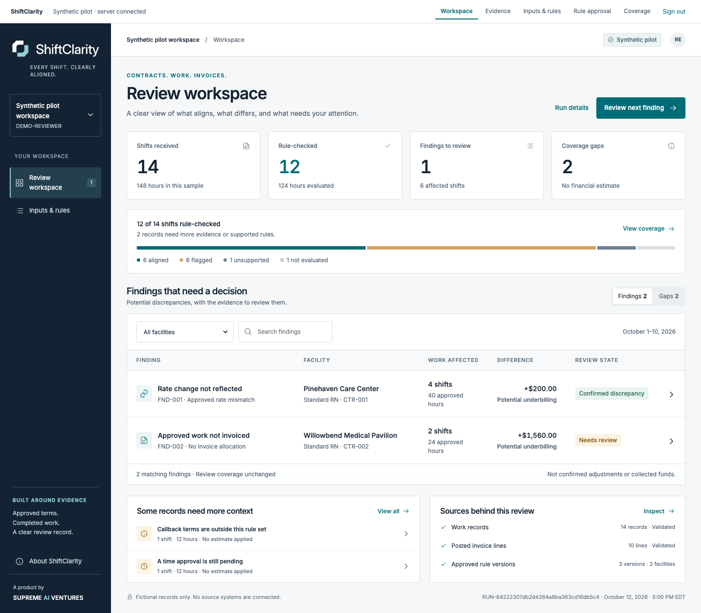
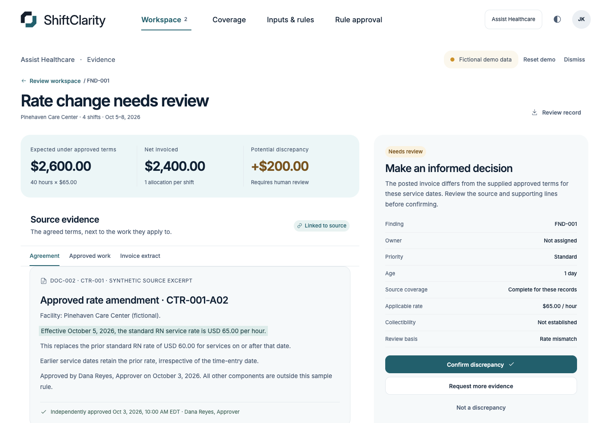
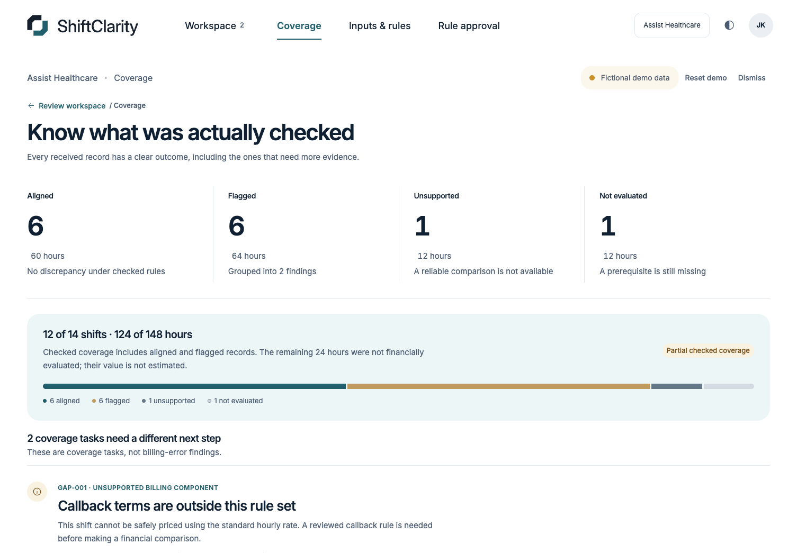
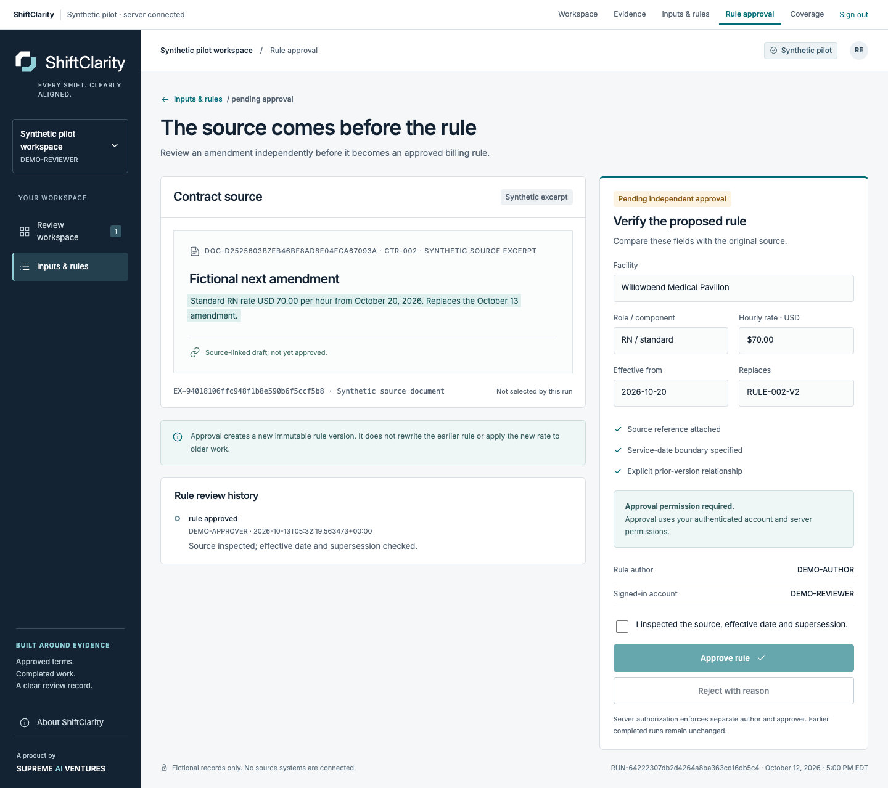

<picture>
  <source media="(prefers-color-scheme: dark)" srcset="public/brand/shiftclarity-wordmark-inverse.svg">
  
</picture>

# ShiftClarity

**Know where approved work, contract terms, and invoices stop agreeing.**

ShiftClarity helps healthcare staffing teams review potential billing discrepancies with the applicable terms, the underlying records, and a clear history of each decision. It also shows what could not be evaluated, so missing information stays visible.

*Every shift. Clearly aligned.* A Supreme AI Ventures product.

[Product](https://shiftclarity.pages.dev/) · [Live demo](https://shiftclarity.pages.dev/demo/) · [Try it locally](#try-it-locally) · [Persistent pilot](https://shiftclarity.pages.dev/pilot/) · [C4 architecture](docs/architecture/README.md) · [Architecture decisions](docs/adr/README.md)

**Current release:** a working synthetic pilot with a React interface, FastAPI backend, Cognito sign-in, private S3 imports, Neon persistence, and Lambda/SQS processing. The hosted standalone demo is open to explore; the persistent cloud workspace requires an assigned account and authenticator. All examples below use fictional records.

## Start with the decision

A rate amendment can be approved while an invoice still uses the old rate. Approved work can be absent from billing. An unsupported term can prevent a reliable calculation. Each situation calls for a different response.

ShiftClarity gives the reviewer one place to:

- Compare approved terms, approved work, and posted invoice lines.
- Trace a potential difference to its source records and calculation.
- Confirm, dismiss, or request evidence with a recorded reason.
- See how much work was checked and which gaps remain unresolved.
- Require a separate authorized person to approve a new rule version.



*The redesigned standalone overview shows fourteen fictional shifts, twelve checked, two findings awaiting review, and two coverage gaps. The signed-in pilot uses the same interface with server persistence.*

## Follow the evidence

The first sample case covers 40 approved hours. The applicable amendment sets the rate at $65/hour, producing **$2,600 expected** against **$2,400 invoiced**. The reviewer can inspect the source excerpt, affected shifts, invoice lines, and **$200 potential discrepancy** before recording a decision.



*The source excerpt and calculation stay beside the decision controls. In the persistent pilot, a material evidence change reopens the finding while preserving earlier decisions.*

The canonical sample also includes 24 approved hours with no qualifying invoice allocation. With its fictional completeness and billing-cutoff declarations, that case produces **$1,560 potential underbilling**. Together, the two cases total **$1,760 potential underbilling**; collection and payment outcomes are unknown.

## Keep uncertainty visible

A record that cannot be checked retains its reason and unknown financial value. Coverage separates aligned work, flagged work, unsupported terms, and work awaiting approval.



*The sample checks 124 of 148 hours. The remaining 24 hours comprise an unsupported callback and a pending time approval; neither receives a financial estimate.*

## Make rule changes accountable

An author registers fictional source text and proposes a dated rule version with an explicit predecessor. A different permitted account reviews the source and approves or rejects the proposal. Earlier completed runs retain the versions they used.



*This canonical fictional proposal takes effect October 13 and is pending approval. The simulated author cannot approve their own rule; the signed-in pilot enforces that separation on the server.*

## Try it locally

For the standalone walkthrough, use Node 22.23.1 and npm:

```sh
git clone https://github.com/manynames3/ShiftClarity.git
cd ShiftClarity
npm ci
npm run dev -- --port 5178
```

Open **http://127.0.0.1:5178/**. Start in Workspace, open the rate-change finding, inspect its sources, record a decision, and visit Coverage. The demo's labeled roles simulate the approval workflow. **Reset demo** restores the canonical sample; refresh also discards this mode's in-memory changes.

The separate persistent pilot uses real individual accounts and server permissions. To run it locally, install uv, Python 3.13, PostgreSQL 17 tools, and a Java runtime supported by Keycloak 26.8.0, then:

```sh
uv venv --python 3.13 backend/.venv
uv pip sync --python backend/.venv/bin/python backend/requirements-dev.lock
npm run pilot
```

Open **http://127.0.0.1:5180/pilot/**. The launcher prepares a dedicated loopback database, verifies the pinned local identity-provider download, and starts the app. Generated local credentials stay in ignored, owner-only `.local/` files. See the [development guide](docs/DEVELOPMENT.md) for roles, OTP enrollment, and isolated test setup.

Pilot imports accept the downloadable normalized **synthetic JSON** template, up to 1 MiB. The [manual staffing exercise](examples/synthetic-healthcare-staffing/README.md) includes a ready-to-import bundle and independent expected results. Imported approval claims cannot grant rule approval. The standalone demo also offers a constrained manual/JSON preview. Use fictional, minimized records throughout this release.

## How it is built

| Part | Responsibility |
|---|---|
| React + TypeScript | Branded workspace, evidence, inputs, rule approval, and coverage views |
| Shared TypeScript engine + decimal.js | Effective-date selection, exact money arithmetic, invoice allocation, and coverage |
| FastAPI + Authlib | API, Cognito integration, short server sessions, and permission checks |
| Neon PostgreSQL + Psycopg | Persistent reviews, immutable revisions/runs, source lineage, jobs, and audit history |
| Private S3 | Quarantined and accepted source objects with gated downloads |
| Lambda + SQS FIFO | On-demand web requests and durable processing without an always-on app server |
| Cloudflare Pages | Static public landing page and same-origin pilot through a fixed-origin proxy |
| Terraform | Reproducible AWS infrastructure |

The browser and backend use the same calculation engine. PostgreSQL transactions govern job claims and completed-run publication. Cognito establishes identity; server-side memberships govern workspace permissions. A container packages the UI, Python service, and Node engine into one versioned image for both Lambda functions.

Read the [C4 context and container diagrams](docs/architecture/README.md), [import/publication sequence](docs/architecture/import-publication.md), and [ADRs](docs/adr/README.md) for the decisions and their tradeoffs. [AWS and database operations](docs/AWS_AND_DATABASE.md) covers deployment and costs. Small storage, secret, log, and usage charges can remain while idle.

The full pilot opens at [shiftclarity.pages.dev](https://shiftclarity.pages.dev/). [Cloudflare operations](docs/CLOUDFLARE.md) explains the proxy, sign-in boundary and roughly $0.60–$1/month idle estimate before credits and shared free allowances.

## Verification

The October 16 visual-reference correction passed **80 unit/component/domain tests, 41 standalone browser checks**, the production build, Lambda runtime checks, and live Pages health/UI/access-denial checks. The product routes and mobile evidence were visually inspected against the approved image.

Recorded verification for the October 13, 2026 synthetic release includes **52 backend tests, 70 domain/component tests, 20 handoff integrity tests, 21 standalone browser cases, and 8 live AWS browser journeys**. It also includes responsive product captures, container execution, a matched Neon/S3 restore rehearsal, and a Terraform drift check.

```sh
npm run test:fixtures
npm test
npm run build
npm run test:e2e
```

Handoff integrity checks require Python 3; browser checks use installed Google Chrome. Backend and persistent-pilot tests require dedicated test databases; use the [development guide](docs/DEVELOPMENT.md). The [verification record](docs/VERIFICATION.md) distinguishes checks actually performed from remaining acceptance gates.

## Scope of this release

This pilot demonstrates a contract-to-invoice review workflow with fictional data. It does not edit source invoices or send evidence requests. Vendor connectors, arbitrary CSV/PDF/OCR ingestion, customer-data use, independent value measurement, and production approval remain separate [pilot gates](docs/PILOT_GATES.md).

The original [build handoff](handoff/START_HERE_CODEX.md) and visual references are preserved unchanged. [Security boundaries](docs/PHASE_4.md), the [threat model](docs/THREAT_MODEL.md), and the [evaluation plan](docs/EVALUATION_PLAN.md) explain the operating limits. Synthetic test results establish no compliance certification, recovered revenue, or production service commitment.
