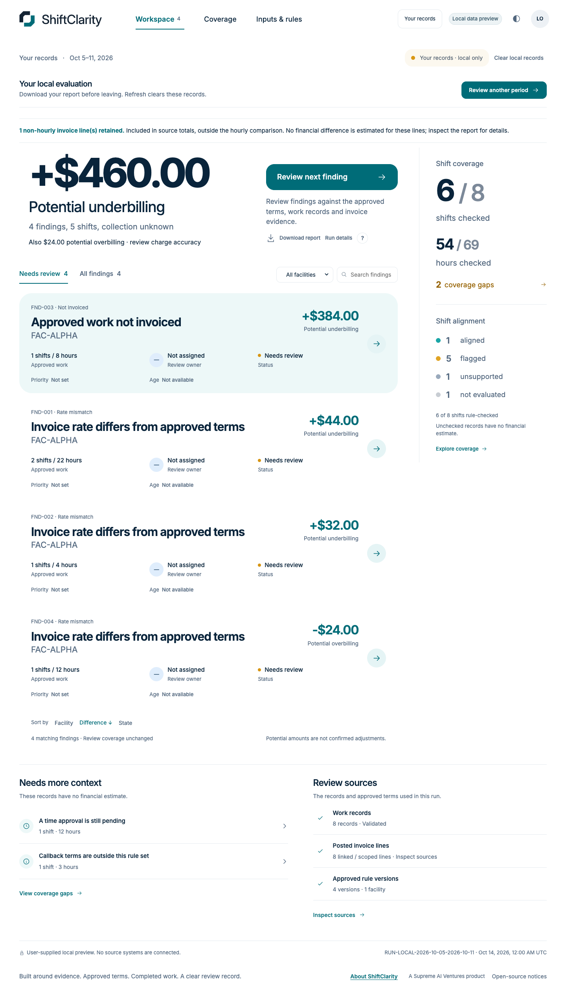

<picture>
  <source media="(prefers-color-scheme: dark)" srcset="public/brand/shiftclarity-wordmark-inverse.svg">
  
</picture>

# ShiftClarity

**Find billing differences. Show the evidence. Make the next decision clear.**

ShiftClarity helps healthcare staffing teams compare approved contract rates, completed work and posted invoices. Test the exports you already have—CSV or Excel—without uploading prospect records. Review potential underbilling and overbilling beside the supporting records, record a decision, assign the next action, and share an Excel or PDF evidence report. Keep each period’s review and verify corrections on a later import.

*Every shift. Clearly aligned.* A Supreme AI Ventures product.

[Explore the hosted demo](https://shiftclarity.pages.dev/demo/) · [Product](https://shiftclarity.pages.dev/) · [Complete spreadsheet walkthrough](docs/SPREADSHEET_WALKTHROUGH.md) · [C4 architecture](docs/architecture/README.md) · [ADRs](docs/adr/README.md)

## Choose how to evaluate

| Your goal | Start here | What happens to the records |
| --- | --- | --- |
| Understand the workflow | [Open the fictional demo](https://shiftclarity.pages.dev/demo/) | Built-in fictional records; in-memory review. |
| Check whether your exports fit | [Test CSV/Excel files locally](https://shiftclarity.pages.dev/demo/?view=files) | No account, records upload, model call or browser record storage. Use authorized, minimized files; refresh clears the review. |
| Evaluate a recurring team process | [Request assigned pilot access](https://shiftclarity.pages.dev/pilot/) | Invite-only synthetic workspace with Cognito MFA, separate rate approval, retained periods, follow-up and reports. Customer cloud use remains gated. |

For local evaluation, select work and posted-billing exports first. Preview sample rows, confirm suggested headers and mappings, use dates found in work records, and enter cutoffs in your reporting timezone. Supply a separately approved rate-register export or enter approved hourly terms directly. Confirm scope, inspect both billing directions, then download Excel/CSV or print/save PDF. The [agency preparation guide](docs/AGENCY_ADOPTION.md) explains where the files come from and what to check.

[See the actual mobile mapping preview](docs/images/guided-import-mobile.png).

The persistent pilot uses Cognito, private S3 and Neon to retain fictional imports, approvals, period reviews and follow-up. A workspace owner manages access. It is not a customer-data production release.

## Answer four billing questions

- **What differs?** Potential underbilling and overbilling, with expected and invoiced amounts.
- **Why?** Applicable dated terms, affected work, signed invoice allocations and source-row references.
- **What needs more evidence?** Coverage gaps stay visible and receive no invented financial estimate.
- **What did we decide?** Confirm, dismiss or request evidence with a recorded reason and preserved history.


The supplied spreadsheet example evaluates **6 of 8 work records** and identifies **$200 potential underbilling**. Four 10-hour shifts use an approved $65 rate against $60 invoiced. Explicit overtime and weekend rows align. One unsupported callback and one pending time approval remain coverage gaps. Collectibility and payment outcomes are unknown.

## Persistent review workflow in the synthetic pilot

1. **Choose a facility and billing period.** Declare source coverage and optionally supply independent control totals.
2. **Upload CSV or Excel.** Add rates, work and invoices/statements; select the worksheet and header.
3. **Confirm the meaning.** Review suggested columns, values, dates, USD formats and time units. Save a verified mapping for the next export.
4. **Validate and approve.** Resolve every blocking row error. A separate permitted account approves new rate versions; unchanged approved rates are reused. For a repeat period, select **Reuse registered approved rates** to upload only work and invoice exports.
5. **Review the result.** Inspect calculations and source evidence, then record the next decision.
6. **Follow through.** Assign an owner, record evidence or a correction reference, and import the corrected source exports. Every affected record must align before a financial case resolves.
7. **Share and revisit.** Download filterable Excel or a branded PDF, then reopen any completed run from **Period history**. Two reviewers can work in different periods.


The next-period example reuses the saved layout and exposes a new export code for confirmation. It starts a fresh review instead of carrying an earlier decision into another billing period. No verified vendor integration is implied.

## A report a billing manager can use

**In the open demo or own-file evaluator:** choose **Download report** beside the workspace summary. Preview the current review, use **Print / save PDF**, **Download Excel**, or **Download CSV**. Everything stays in your browser. The same action is available from evidence and inputs.

**In the signed-in pilot:** choose **Download report**, then **Download PDF** or **Download Excel** for server-generated `.pdf` / `.xlsx` files.

Private-pilot Excel includes summary, findings, work calculations, itemized invoice allocations, approved terms, source lineage, review history, coverage gaps and a ninth **Follow-up** sheet. PDF combines a management summary with calculations and evidence references. Private-pilot reports use the **selected period’s saved reviews**, including undecided findings. Latest follow-up is labeled separately from the original financial evidence.

Worker identity fields and reviewer free-text notes are omitted by default. Notes require explicit opt-in. Spreadsheet cells are literal text rather than executable formulas; raw source fingerprints are replaced by hashes. Invoiced totals for unchecked work remain separate from the evaluated-work comparison.


[Open the varied sample PDF](docs/examples/realistic-billing-review.pdf) · [Excel report](docs/examples/realistic-billing-review.xlsx) · [Uploadable CSV input kit](docs/examples/realistic-billing-inputs.zip)

This richer example has **18 shifts at two facilities**, seven rates, varied hours, regular/overtime/weekend billing, partial and missing billing, an overcharge, and a signed credit/rebill. It includes eight aligned shifts and two explicit coverage gaps. The actual import/approval/review/export API derives **$905 potential underbilling** and **$33.25 potential overbilling**. See the [inputs, independent expected results and manual instructions](public/examples/realistic-billing/README.md). The cases are deliberately varied, not a claim about typical error prevalence.

The [compact $200 sample PDF](docs/examples/fictional-billing-review.pdf) remains available for the original quickstart.

**Period history** retains earlier reviews and reports. **Follow-up queue** shows assigned and team cases across periods, including resolved cases and their verification run. Correct invoices in the existing billing system; ShiftClarity records and verifies the follow-up without editing the source system or claiming collected revenue. [See the retained correction record](docs/images/workflow-followup-mobile.png).

## A realistic first-customer evaluation

[Try the fictional agency kit](public/examples/agency-evaluation/EXPECTED_RESULTS.md) before selecting your own records. CSV and values-only Excel versions include varied hours and contract components, missing billing, a signed credit/rebill and a non-hourly fee. The independent expected result is **$460 potential underbilling and $24 potential overbilling**, with **6 of 8 work records evaluated**. Pending time and unsupported callback terms have no estimate; the $25 fee stays in invoice totals outside hourly comparison. These are invented cases, not measured customer savings.

[Download the actual browser-generated Excel report](docs/examples/agency-local-billing-review.xlsx) · [View its PDF review](docs/examples/agency-local-billing-review.pdf).



For repeat reviews, download confirmed mappings without source rows. New source codes remain unconfirmed; fixed approval dates and approval/posting statuses are cleared. In the persistent pilot, **Use next consecutive period** copies the selected interval/facility, proposes registered rates and requires fresh source timestamps and scope declarations. File errors are grouped into causes with a full correction download.

[First-review acceptance tasks](docs/UNASSISTED_EVALUATION.md) define proposed first/repeat-review targets and how to record unassisted customer results. These targets are not measured outcomes.

[Agency adoption research and walkthrough](docs/AGENCY_ADOPTION.md) explains Bullhorn detailed transactions, the limitations of Avionté weekly sheet views, VMS credit/memo preparation and independent rate evidence. These are source-informed preparation guides, not native integrations or certified vendor exports.

[View the updated agency landing page](docs/images/agency-landing-desktop.png) · [Mobile view](docs/images/agency-landing-mobile.png).

## Try it locally

Assigned reviewers can use the [hosted spreadsheet workflow](https://shiftclarity.pages.dev/pilot/) with their own authenticator and a separate permitted approver for new rates. Owners create private accounts in **Workspace & team**, choose permissions and share one-time access details privately. New members change their password and enroll an authenticator; no invitation is emailed. There is no public signup. Start with the [fictional walkthrough](docs/SPREADSHEET_WALKTHROUGH.md).

The same workflow runs locally. Prerequisites: Node 22, Python 3.13, uv, PostgreSQL 17 tools and a Java runtime supported by the pinned Keycloak 26.8.0 development provider.

```sh
git clone https://github.com/manynames3/ShiftClarity.git
cd ShiftClarity
npm ci
uv venv --python 3.13 backend/.venv
uv pip sync --python backend/.venv/bin/python backend/requirements-dev.lock
npm run pilot
```

Open **http://127.0.0.1:5180/pilot/**. The launcher defaults to the dedicated local database, prepares distinct accounts and preserves existing local records. Generated credentials stay in ignored, owner-only `.local/accounts.json`. Use **reviewer** to import/review and **approver** in a separate browser profile to approve first-time rates. Each account enrolls its own authenticator. See [Development](docs/DEVELOPMENT.md) for setup and test isolation.

Start with the built-in downloads or [fictional files](public/examples/spreadsheets/). Follow the [first- and second-period walkthrough](docs/SPREADSHEET_WALKTHROUGH.md) and compare against the independent expected-results file. No code changes or JSON preparation are required for this workflow.

For the standalone memory-only demonstration, `npm run dev -- --port 5178` opens the original fictional fixture. Refresh/reset restores it. Its role controls are simulations; the persistent pilot enforces permissions on the server.

## Supported billing, with clear limits

| Supported | Boundary |
|---|---|
| Standard USD hourly rates; different facilities/roles; effective amendments | Explicit approved terms and nonconflicting versions |
| Overtime, holiday, weekend, on-call and callback | Separately segmented work and explicit flat hourly rates; no inferred thresholds, calendars or multipliers |
| Missing/partial/duplicate billing, credits, voids and rebills | Signed posted allocations, explicit chain/reference support and declared source completeness |
| Hospital-style/reverse-billing statements | Confirmed fields and exact references or a unique composite match; ambiguity becomes a gap |
| Saved workspace mappings | Exact header signature, current source values and explicit reconfirmation |
| Multiple CSV/XLSX files | Nine files, 2 MiB/file, 1,000 work records, 2,000 invoice lines and 150 rate versions per review; size guards also apply |

Use stable pseudonymous reference codes and time that resolves to whole minutes. Credit amounts must be negative; explicit negative credit quantities normalize to absolute minutes. Export values rather than formulas/macros. Larger, ambiguous or unsupported data is rejected or left unevaluated. See the [capability matrix](docs/BILLING_CAPABILITIES.md) and [format/recovery guide](docs/SPREADSHEET_WALKTHROUGH.md#bounds-and-recovery).

Bullhorn, Avionté, QuickBooks and VMS names are potential source formats to verify with representative files, **not certified integrations**. This release does not infer guarantees, rounding policies, non-hourly fees or recovered revenue. It does not edit invoices, process payroll, collect payments or send evidence requests.

## Built on the existing architecture

| Part | Responsibility |
|---|---|
| React + TypeScript | Guided imports, evidence, period history, follow-up, team setup and reports |
| Shared TypeScript engine + decimal.js | Exact money, effective dates, allocations and coverage decisions |
| FastAPI + Authlib | Cognito/OIDC sessions, CSRF and server-side workspace permissions |
| PostgreSQL / Neon + Psycopg | Durable reviews, forced-RLS mappings/imports, immutable sources/rules/runs and audit history |
| Private S3 | Quarantined and accepted originals with gated downloads |
| Lambda + SQS | Existing on-demand web and durable processing path |
| Cloudflare Pages | Public landing and fixed-origin proxy for the signed-in pilot |
| OpenPyXL + DefusedXML + ReportLab | Bounded spreadsheets, hardened XML parsing and evidence reports |

The three reporting/import libraries were explicitly approved. The upgrade adds no paid AI API, new cloud service or always-on infrastructure. Migration **004** adds onboarding sessions, files and profiles; **005** protects their accepted identities/content. The browser evaluator adds no migration or cloud service. Migrations **006–009** add period reviews, follow-up, owner-managed access and verified provider identity bindings. Owner migrations remain outside request handling. [ADRs](docs/adr/README.md), [C4 views](docs/architecture/README.md) and the [import sequence](docs/architecture/import-publication.md) explain the boundaries.

Quarantine originals expire after one day and accepted original bytes after 30 days. Raw previews are removed at acceptance. Derived immutable evidence persists until an owner-authorized purge; this is not an approved customer retention policy. See [security controls](docs/PHASE_4.md), the [threat model](docs/THREAT_MODEL.md) and [hosted operations](docs/AWS_AND_DATABASE.md).

## Verify the result

```sh
npm run test:fixtures
npm test
npm run build
npm run build:engine
npm run test:backend
npm run test:e2e
SC_ALL_DEMO_TESTS=1 npx playwright test -c playwright.adoption.config.ts
python3 scripts/sync-local-table-schema.py --check
npm run test:mvp
```

The commands above use disposable **local** databases and refuse cloud targets. The MVP browser journey imports XLSX files, confirms/saves mappings, obtains separate-account approval, downloads both reports, repeats another period with a new source value, and verifies a correction while preserving the earlier review and case history. Its local sessions are provisioned for testing. A separate authorized [hosted verification](docs/VERIFICATION.md#october-23-2026--hosted-spreadsheet-mvp) uses real Cognito MFA; it writes fictional records to the assigned pilot. Original fixture and demo regressions remain separate.

See [actual verification results](docs/VERIFICATION.md), [Claude review disposition](docs/CLAUDE_MVP_REVIEW.md), [acceptance evidence](ACCEPTANCE_CHECKLIST.md) and [implementation plan](docs/MVP_IMPLEMENTATION_PLAN.md). Screenshots show running software and generated reports with fictional records.

## Before a persistent customer pilot

Browser-local file evaluation is available within its stated limits. Customer records remain disabled in the persistent cloud pilot.

1. Verify representative approved, scrubbed exports and contract semantics, including unsupported billing/rounding cases.
2. Approve data use, privacy/contracts, access, retention, incident response and recovery responsibilities.
3. Independently measure accuracy, coverage and review effort against the customer's current process; validate representative operating capacity and approve deployment.

The [original handoff](handoff/START_HERE_CODEX.md) remains unchanged. Synthetic tests establish no HIPAA compliance, production certification, SLA, competitor superiority or actual revenue recovery.
