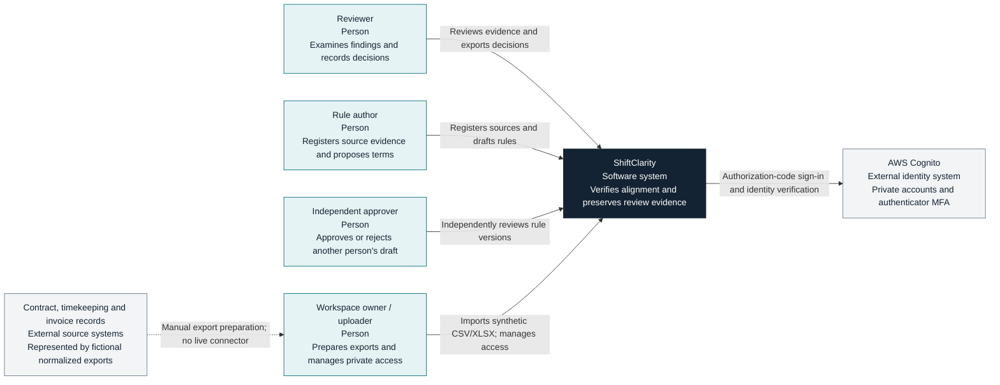
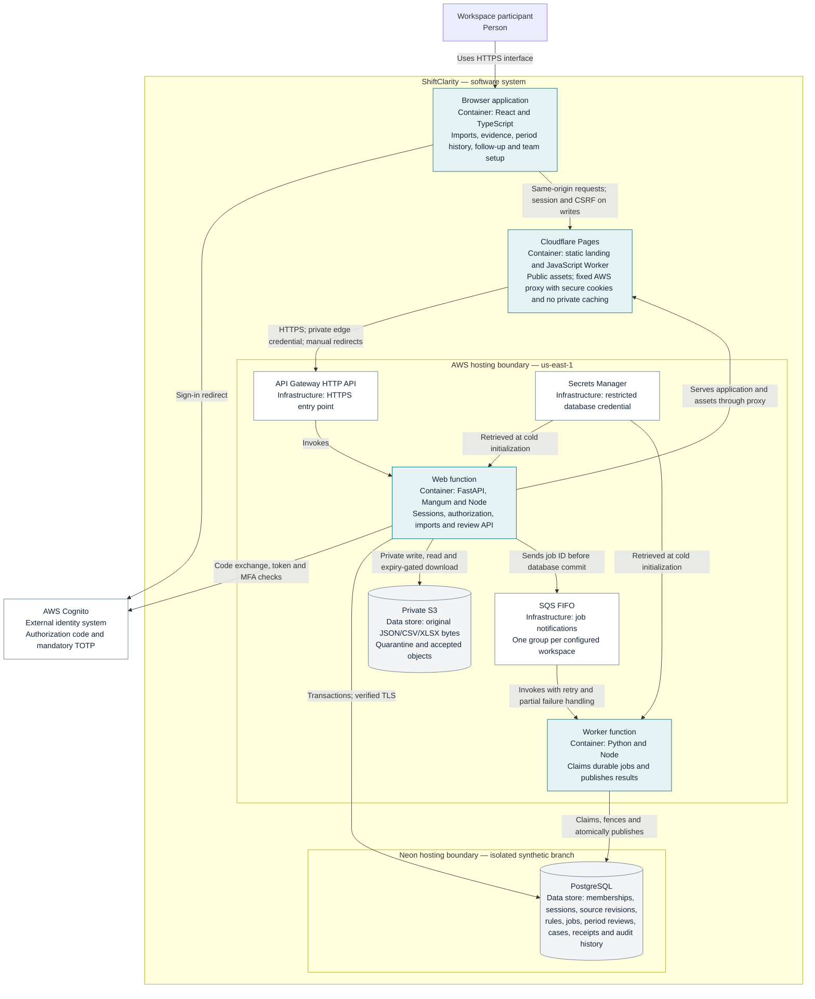
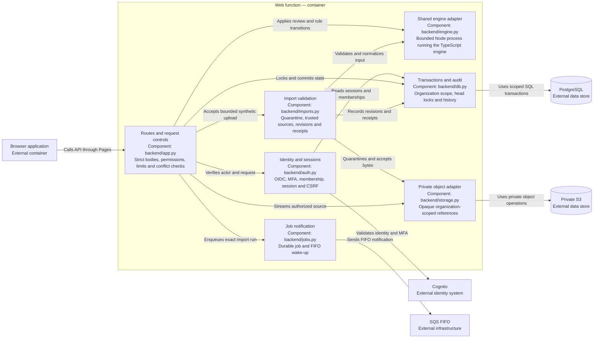
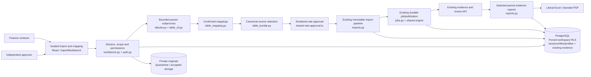
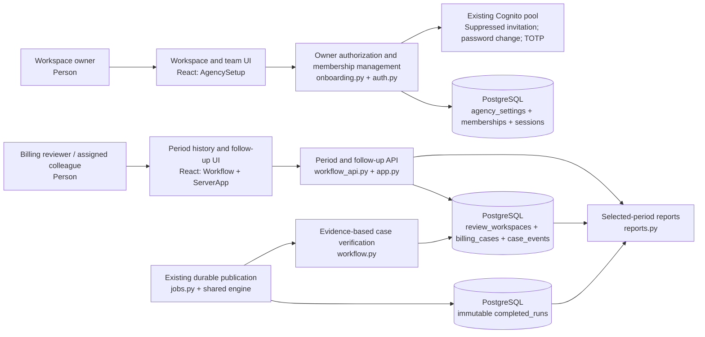
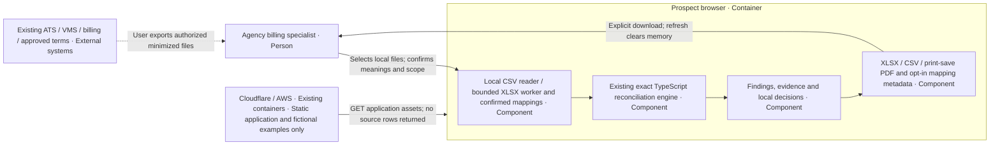
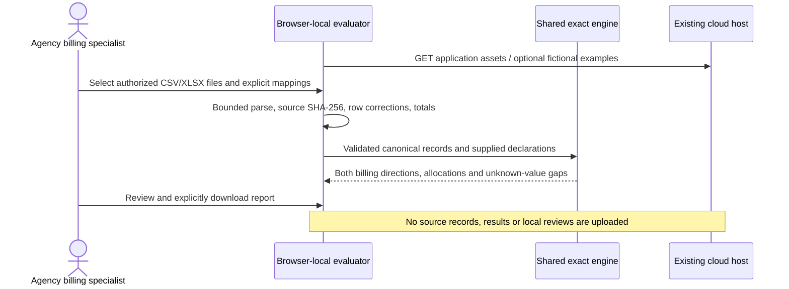

# Architecture

ShiftClarity compares approved work and posted invoices against independently approved, effective contract terms. It publishes an explainable result, preserves the evidence used, and records the human review. Missing support becomes a coverage task with an unknown monetary value.

The public root serves a static landing page from Cloudflare Pages; its dedicated `/landing/` assets do not invoke AWS.

These C4 views describe the **deployed synthetic pilot**, not a proposed production platform. All records are fictional. The standalone `/demo/` experience remains memory-only. Its separate `?view=files` evaluator accepts authorized minimized CSV/XLSX exports entirely in the browser; those records never enter the cloud containers below.

The CSV/XLSX onboarding and Excel/PDF reports extend these same containers in the **deployed synthetic MVP**, released October 23, 2026. See the [spreadsheet component view](#c4-level-3-spreadsheet-mvp) and [walkthrough](../SPREADSHEET_WALKTHROUGH.md). No new cloud service is introduced.

## C4 level 1: system context



The operator-supplied snapshots are the boundary with source systems. ShiftClarity does not edit invoices, connect to customer systems, or send evidence requests. A verified identity still needs an active workspace membership. The author cannot approve their own draft.

## C4 level 2: containers

In C4, a container is an application or data store. The web function and worker are separate runtime containers built from the **same Docker image**. AWS services are labeled as infrastructure so the diagram does not imply a collection of custom microservices.



The worker reads validated normalized data from PostgreSQL; it does not download the original S3 object to calculate a run. SQS wakes work, while PostgreSQL remains the authority for job status and publication. See the [import and publication sequence](import-publication.md) for failure and retry behavior.

The diagram omits supporting operations resources: a FIFO dead-letter queue and alarm, seven-day CloudWatch logs, ECR for the verified image, a private encrypted and versioned Terraform state bucket, and an account budget. Deployment uses a dedicated role; the application uses a separate restricted runtime role. A budget and endpoint throttling provide visibility and traffic control, not a hard spending cap.

## C4 level 3: web function components

The components below run within one web function. They are code boundaries, not independently deployed services.



## Boundaries that matter

| Boundary | Implemented behavior | Practical limit |
| --- | --- | --- |
| Identity to workspace | Cognito identity verification plus active server-side membership and role checks | Sign-in does not establish permission to use a workspace. |
| Browser to API | Short server sessions; exact Origin and session-bound CSRF checks on writes | The local provider is loopback-only development infrastructure. |
| Pages to AWS | Fixed upstream, exact gateway host and private edge credential; redirects are not followed by the proxy | Edge identity grants no user permission. Preview hosts are denied; the record-free health endpoint remains public. |
| API to data | Restricted nonowner PostgreSQL role; forced RLS on organization-scoped evidence/workflow tables | Identity/session tables use server checks. This synthetic single-workspace build is not evidence of a multi-customer operating model. |
| Upload to trusted evidence | Bounded exact-schema JSON, registered rule/source matching, revision conflicts and private quarantine | A synthetic declaration cannot classify or authorize real personal information. |
| Calculation to publication | Shared exact-decimal engine; immutable completed run, head update and audit event committed together | Missing or unsupported evidence can require abstention rather than a financial finding. |
| Runtime to historical records | Database permissions and triggers prevent application edits to immutable records | Administrators retain maintenance authority; there is no cryptographic tamper-evidence or S3 Object Lock claim. |

## Code and decision map

| Area | Source | Decision |
| --- | --- | --- |
| Shared calculations | [TypeScript engine](../../src/domain/engine.ts), [server adapter](../../src/adapters/server-cli.ts), [Python boundary](../../backend/engine.py) | [ADR 0001](../adr/0001-shared-deterministic-engine.md) |
| Event-driven deployment | [Lambda handlers](../../backend/lambda_handler.py), [jobs](../../backend/jobs.py), [Terraform](../../infra/main.tf), [Dockerfile](../../Dockerfile) | [ADR 0002](../adr/0002-event-driven-aws-pilot.md) |
| Authentication and approval | [Authentication](../../backend/auth.py), [API](../../backend/app.py) | [ADR 0003](../adr/0003-cognito-and-server-authorization.md) |
| Persistence and isolation | [Transactions](../../backend/db.py), [schema](../../backend/migrations/001_initial.sql) | [ADR 0004](../adr/0004-neon-postgres-and-rls.md) |
| Imports and evidence | [Import boundary](../../backend/imports.py), [storage](../../backend/storage.py), [import immutability](../../backend/migrations/003_import_immutability.sql) | [ADR 0005](../adr/0005-private-versioned-evidence.md) |

The [ADR index](../adr/README.md) records why these choices were made. [Phase 4 controls](../PHASE_4.md), the [threat model](../THREAT_MODEL.md), and [implementation evidence](../../IMPLEMENTATION_STATUS.md) provide the detailed verification and remaining gates. Real customer data, approved retention and incident operations, independent evaluation, and production approval remain separate requirements.

## C4 level 3: spreadsheet MVP

These components run inside the existing React browser and FastAPI container. PostgreSQL/S3 are the existing storage boundaries; local checks use isolated PostgreSQL and private local files.



A spreadsheet mapping never grants approval or changes the engine's financial rules. Original files and unmapped previews are not report content. Accepted previews are removed; current reports draw on normalized evidence and hashed references. See [ADR 0007](../adr/0007-confirmed-spreadsheet-adapters.md), [ADR 0008](../adr/0008-current-review-evidence-reports.md) and the [billing matrix](../BILLING_CAPABILITIES.md).

## C4 level 3: recurring review and team access

These components extend the same React, FastAPI and PostgreSQL containers. They add no cloud service. See [ADR 0009](../adr/0009-periods-and-follow-up.md) and [ADR 0010](../adr/0010-owner-managed-access.md).



```mermaid
sequenceDiagram
  actor Reviewer
  participant UI as Selected-period browser
  participant API as FastAPI
  participant DB as Existing PostgreSQL
  participant Worker as Existing SQS worker
  Reviewer->>UI: Record correction reference
  UI->>API: CSRF-protected, versioned case action
  API->>DB: Save case and append event atomically
  Reviewer->>UI: Import corrected source exports
  UI->>API: Validate, accept and request run
  Worker->>DB: Publish immutable result and period workspace
  Worker->>DB: Check every affected work reference
  alt All affected financial records evaluate aligned
    Worker->>DB: Resolve case with verification run reference
  else Evidence incomplete, missing or still discrepant
    Worker->>DB: Retain unresolved follow-up
  end
  Reviewer->>UI: Open an earlier period and download report
  UI->>API: Selected run ID
  API->>DB: Read period decisions and latest scoped follow-up
  API-->>UI: Private PDF/XLSX; original financial evidence retained
```

## C4 level 3: browser-local prospect evaluation





[ADR 0011](../adr/0011-browser-local-agency-evaluation.md) records why this path does not imply customer-cloud approval or a vendor connector. [Agency adoption research](../AGENCY_ADOPTION.md) maps the source evidence and testable assumptions.


The browser-local evaluation component now includes file-first preparation (`LocalFiles`), deterministic header/period/source guidance (`local-guidance`) and direct approved-term entry (`RateEntry`). All feed the existing confirmed LocalSource adapter and shared engine; no new container, network boundary or persistent store is introduced. See [ADR 0012](../adr/0012-guided-local-preparation.md).
