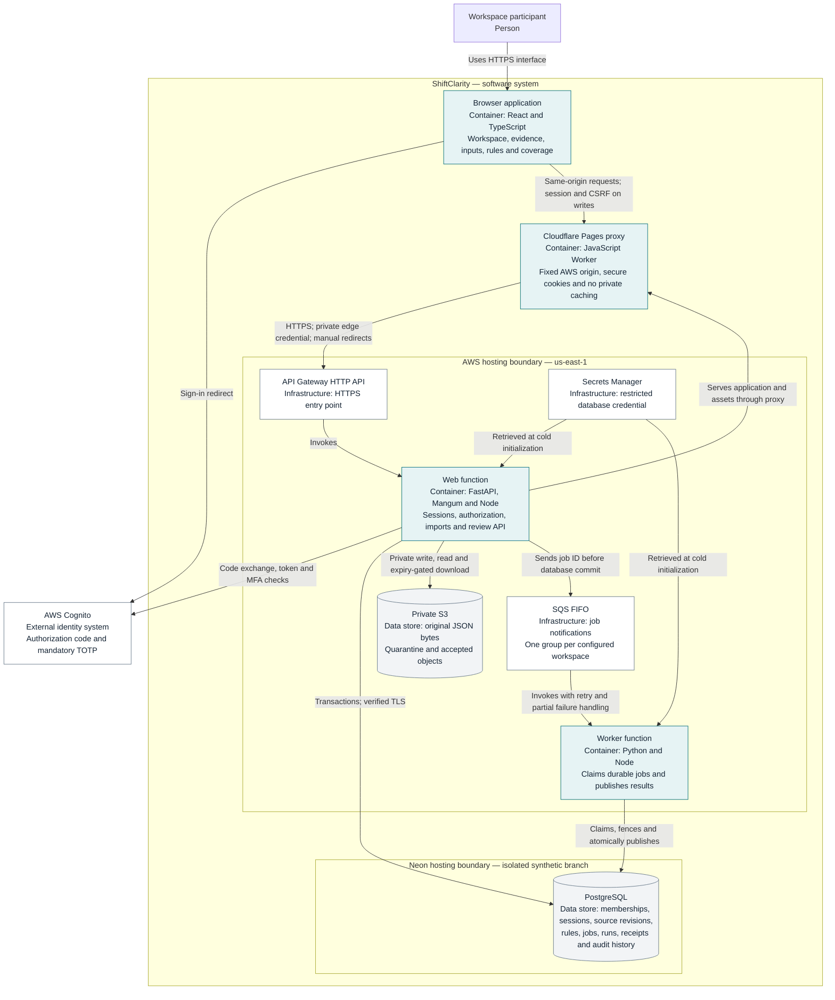
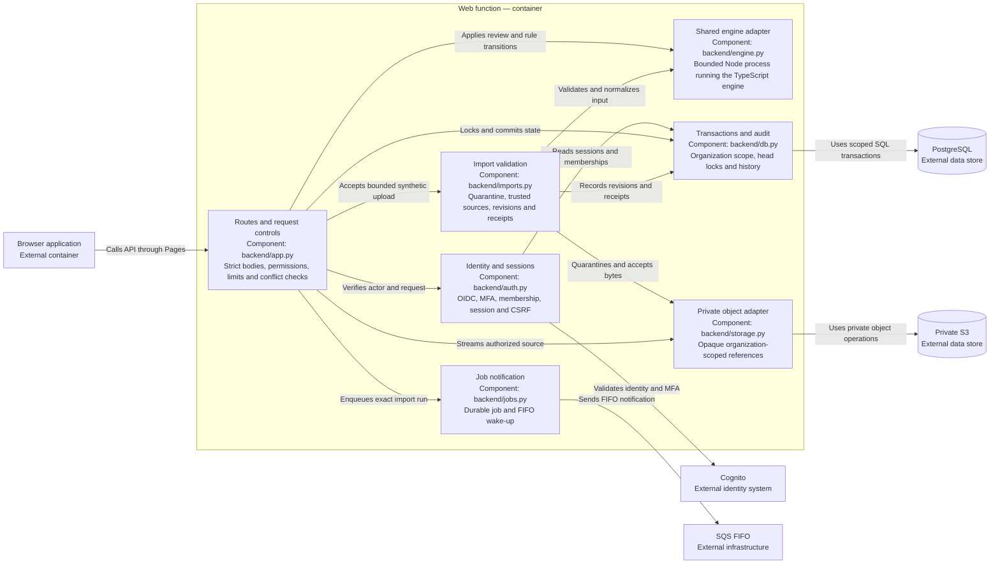

# Architecture

ShiftClarity compares approved work and posted invoices against independently approved, effective contract terms. It publishes an explainable result, preserves the evidence used, and records the human review. Missing support becomes a coverage task with an unknown monetary value.

These C4 views describe the **deployed synthetic pilot**, not a proposed production platform. All records are fictional. The standalone `/demo/` experience remains a separate, memory-only demonstration.

## C4 level 1: system context

The operator-supplied snapshots are the boundary with source systems. ShiftClarity does not edit invoices, connect to customer systems, or send evidence requests. A verified identity still needs an active workspace membership. The author cannot approve their own draft.

## C4 level 2: containers

In C4, a container is an application or data store. The web function and worker are separate runtime containers built from the **same Docker image**. AWS services are labeled as infrastructure so the diagram does not imply a collection of custom microservices.

The worker reads validated normalized data from PostgreSQL; it does not download the original S3 object to calculate a run. SQS wakes work, while PostgreSQL remains the authority for job status and publication. See the [import and publication sequence](import-publication.md) for failure and retry behavior.

The diagram omits supporting operations resources: a FIFO dead-letter queue and alarm, seven-day CloudWatch logs, ECR for the verified image, a private encrypted and versioned Terraform state bucket, and an account budget. Deployment uses a dedicated role; the application uses a separate restricted runtime role. A budget and endpoint throttling provide visibility and traffic control, not a hard spending cap.

## C4 level 3: web function components

The components below run within one web function. They are code boundaries, not independently deployed services.

## Boundaries that matter

| Boundary | Implemented behavior | Practical limit |
| --- | --- | --- |
| Identity to workspace | Cognito identity verification plus active server-side membership and role checks | Sign-in does not establish permission to use a workspace. |
| Browser to API | Short server sessions; exact Origin and session-bound CSRF checks on writes | The local provider is loopback-only development infrastructure. |
| Pages to AWS | Fixed upstream, exact gateway host and private edge credential; redirects are not followed by the proxy | Edge identity grants no user permission. Preview hosts are denied; the record-free health endpoint remains public. |
| API to data | Restricted nonowner PostgreSQL role; forced RLS on organization-scoped evidence/workflow tables | Identity/session tables use server checks. This synthetic single-workspace build is not evidence of a multi-customer operating model. |
| Upload to trusted evidence | Bounded exact-schema JSON, registered rule/source matching, revision conflicts and private quarantine | A synthetic declaration cannot classify or authorize real personal information. |
| Calculation to publication | Shared exact-decimal engine; immutable completed run, head update and audit event committed together | Missing or unsupported evidence can require abstention rather than a financial finding. |
| Runtime to historical records | Database permissions and triggers prevent application edits to immutable records | Administrators retain maintenance authority; there is no cryptographic tamper-evidence or S3 Object Lock claim. |

## Code and decision map

| Area | Source | Decision |
| --- | --- | --- |
| Shared calculations | [TypeScript engine](../../src/domain/engine.ts), [server adapter](../../src/adapters/server-cli.ts), [Python boundary](../../backend/engine.py) | [ADR 0001](../adr/0001-shared-deterministic-engine.md) |
| Event-driven deployment | [Lambda handlers](../../backend/lambda_handler.py), [jobs](../../backend/jobs.py), [Terraform](../../infra/main.tf), [Dockerfile](../../Dockerfile) | [ADR 0002](../adr/0002-event-driven-aws-pilot.md) |
| Authentication and approval | [Authentication](../../backend/auth.py), [API](../../backend/app.py) | [ADR 0003](../adr/0003-cognito-and-server-authorization.md) |
| Persistence and isolation | [Transactions](../../backend/db.py), [schema](../../backend/migrations/001_initial.sql) | [ADR 0004](../adr/0004-neon-postgres-and-rls.md) |
| Imports and evidence | [Import boundary](../../backend/imports.py), [storage](../../backend/storage.py), [import immutability](../../backend/migrations/003_import_immutability.sql) | [ADR 0005](../adr/0005-private-versioned-evidence.md) |

The [ADR index](../adr/README.md) records why these choices were made. [Phase 4 controls](../PHASE_4.md), the [threat model](../THREAT_MODEL.md), and [implementation evidence](../../IMPLEMENTATION_STATUS.md) provide the detailed verification and remaining gates. Real customer data, approved retention and incident operations, independent evaluation, and production approval remain separate requirements.
