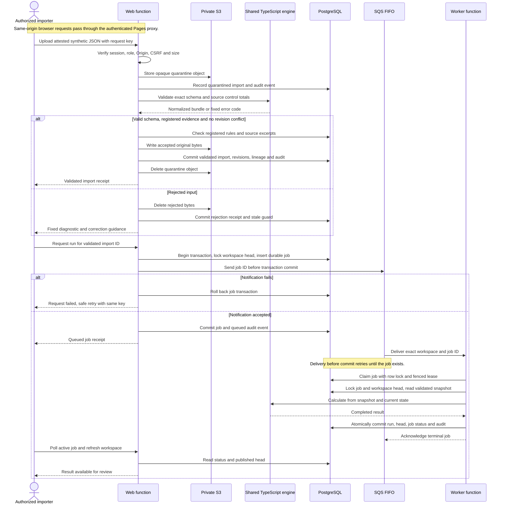

# Import and publication

This dynamic view expands the [C4 container diagram](README.md#c4-level-2-containers). A run uses one validated, unexpired import ID so its source and rule manifest cannot be mixed with another snapshot.



The sequence shows the successful worker path. Calculation failure returns the job for a bounded retry or marks it terminal; a terminal failure retains the previous result and blocks review as stale. A valid subsequent publication clears that guard.

## Why retries do not create new amounts or decisions

- Content hashes and source revision identities prevent an identical upload from adding duplicate financial rows. Conflicting content for an existing work revision is rejected.
- A request key identifies an operation. Reusing it for different content is a conflict; an exact retry returns the previous receipt.
- A **new attempt** to upload previously rejected content records the failure and blocks review again. Retrying the original failed request after recovery returns its receipt without making the recovered run stale again.
- SQS is a notification mechanism. The worker accepts only the configured queue, workspace and job ID. PostgreSQL leases fence reclaimed workers; completed or failed jobs acknowledge delivery replay without another publication.
- Reviews verify the current run ID, evidence fingerprint and optimistic version while locking the workspace head. Stale or changed evidence cannot receive a decision from an old screen.

## Transactions and their limits

The database is the publication authority. The completed run, workspace head, job completion and audit event share one transaction. Object writes and queue delivery do **not** form a distributed transaction with PostgreSQL. Sending the notification before commit makes a failed send roll the job transaction back; a notification that arrives early is retried. Object failures or interrupted quarantine are handled through retryable import state, opaque references and lifecycle expiry.

The cloud worker uses a 60-second database lease and at most three job attempts. Its Lambda timeout is 30 seconds; queue visibility is 180 seconds. The FIFO event mapping processes one message at a time and reports failures for redelivery. Queue exhaustion goes to a dead-letter queue with a visible alarm. No recurring recovery sweep or external incident notification recipient is configured.

Accepted originals expire after 30 days and quarantine objects after one day. Normalized completed runs, rules and audit history need a separately approved retention policy before real data. [ADR 0005](../adr/0005-private-versioned-evidence.md) explains the evidence boundary; the [threat model](../THREAT_MODEL.md) records the remaining operating limits.

Source: [API](../../backend/app.py), [imports](../../backend/imports.py), [jobs](../../backend/jobs.py), [Lambda handlers](../../backend/lambda_handler.py), and [infrastructure](../../infra/main.tf).

## Spreadsheet MVP entry path (local, not deployed)

```mermaid
sequenceDiagram
 actor Reviewer
 actor Approver
 participant API as Existing FastAPI service
 participant Parser as Bounded parser subprocess
 participant DB as Workspace-scoped PostgreSQL
 participant Originals as Private originals
 Reviewer->>API: Choose facility/period and declared source scope
 Reviewer->>API: Upload attested CSV/XLSX files
 API->>Originals: Quarantine exact bytes
 API->>Parser: Bounded parse; no service credentials
 Parser-->>Reviewer: Suggested fields/values and limited preview
 Reviewer->>API: Confirm mapping and formats; optionally save profile
 API->>DB: Validate complete source selection and revision conflicts
 Approver->>API: Inspect originals and independently approve new terms
 API->>DB: Lock workspace; register immutable rule versions
 Reviewer->>API: Explicitly accept validated selection
 API->>API: Existing canonical import/revision checks
 API->>Originals: Retain accepted originals for 30 days
 API->>DB: Freeze selection; remove raw previews
 Reviewer->>API: Run accepted import
 Note over API,DB: Existing durable job/publication sequence above remains authoritative
 Reviewer->>API: Record decisions and download Excel/PDF
 API->>DB: Read current review snapshot and audit download
 API-->>Reviewer: Evidence report, gaps and all review states
```

A repeated mapping exposes new source values for confirmation. Unchanged approved rates are reused; another period has a distinct dataset identity and fresh review state. A failed source selection publishes no partial run and does not invalidate a previous guided review. Download the current report before advancing; historical report navigation is not part of this MVP.
